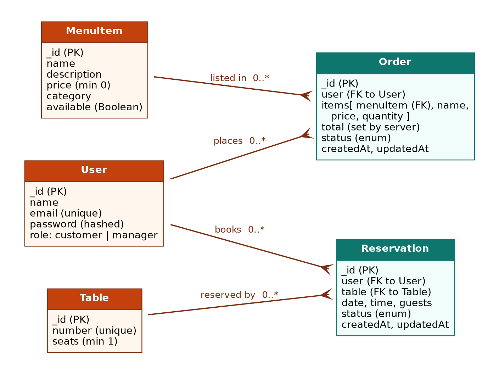
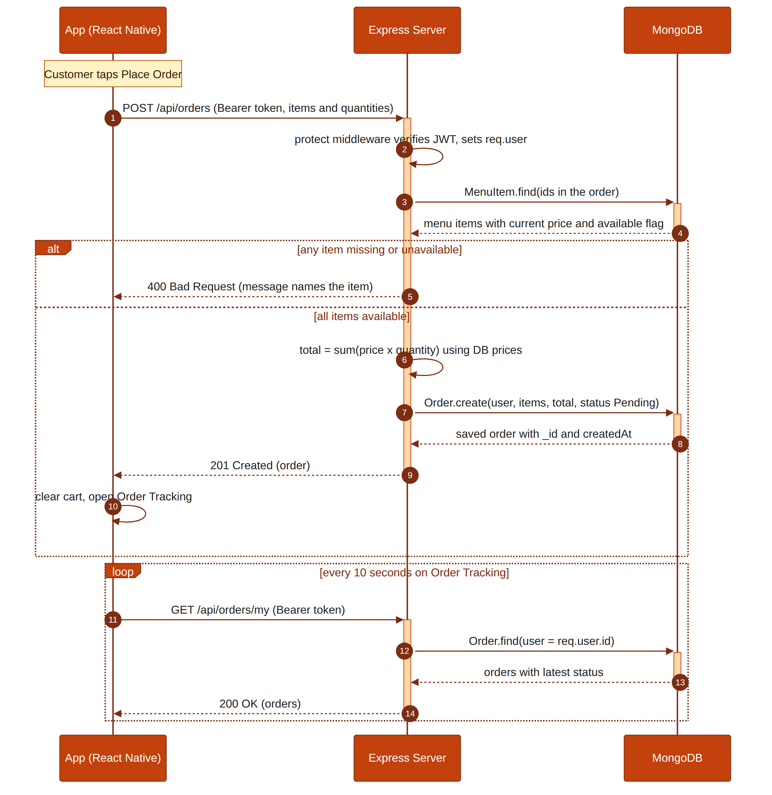
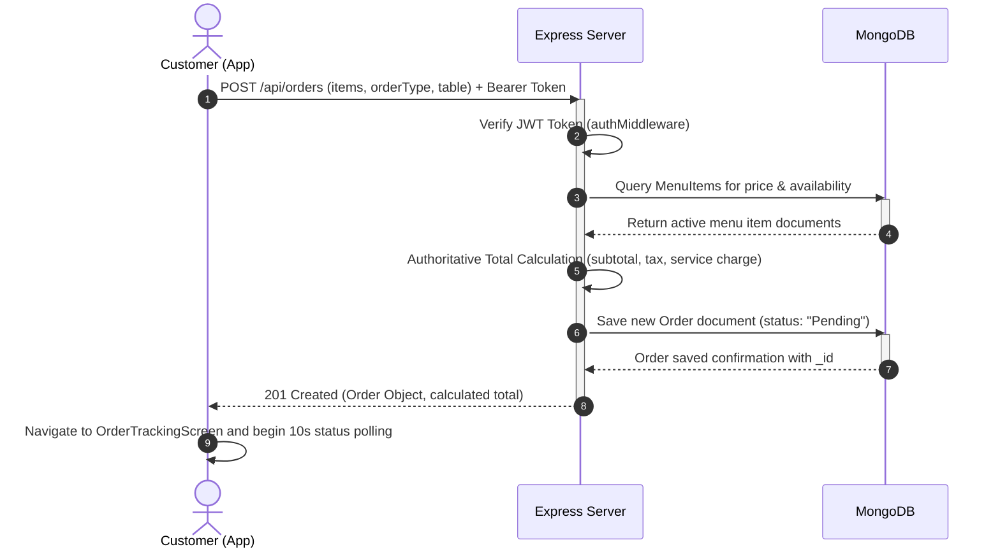
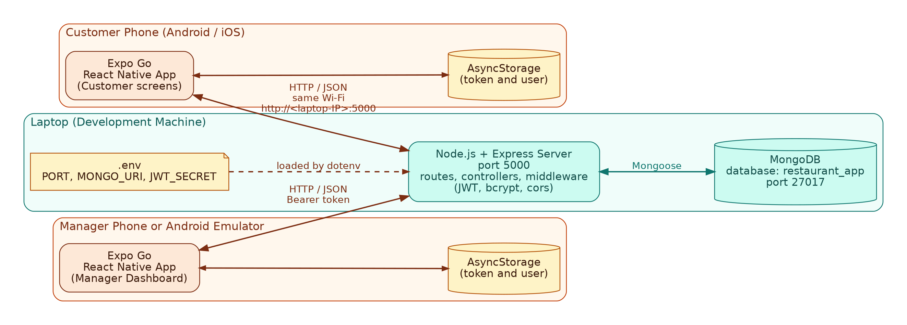
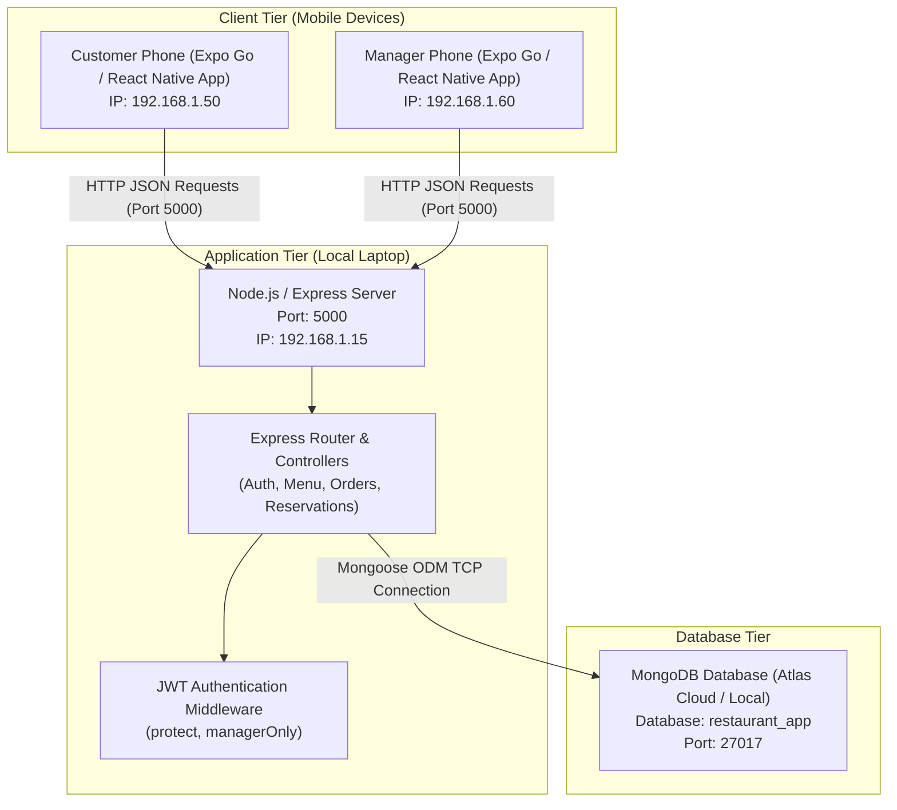

# Software Requirements Specification (SRS v2.0)
## Restaurant Mobile Application with Express & MongoDB Backend
**Course:** Mobile Application Development (Fall 2026)  
**Deliverable:** Assignment 2 — SRS Update and API Architecture  

---

## 1. Introduction

### 1.2 Scope
In Assignment 1, the Restaurant App functioned as an isolated client application using local state and mock data. In this release (v2.0), the scope is updated to include a centralized backend server and cloud database to eliminate data fragmentation.

#### In-Scope (v2.0)
- **Node.js & Express RESTful Server:** Serving centralized business logic and HTTP API endpoints.
- **MongoDB Database (via Mongoose ODM):** Centralized persistence for user accounts, menu items, table layouts, reservations, and customer orders.
- **Authentication & Security:** JSON Web Token (JWT) based stateless authorization and `bcryptjs` password hashing.
- **Multi-Device Synchronization:**
  - *Problem 1 (Order invisibility):* "I placed an order from my phone, but when I checked on my brother's phone it wasn't there."  
    **Solution:** Orders are posted directly to the MongoDB database via `POST /api/orders` and retrieved on any device logged into that account via `GET /api/orders/my`.
  - *Problem 2 (Manager dish pricing & availability):* "When a dish runs out, I want to mark it unavailable once and have every customer see it."  
    **Solution:** When a manager updates an item price or toggles availability via `PUT /api/menu/:id`, the change updates the database instantly; all connected customer devices read directly from `GET /api/menu`.
  - *Problem 3 (Real-Time Order Tracking):* Polling every 10 seconds ensures state transitions made on manager devices reflect automatically on the customer's tracking screen without restarting the app.

#### Out-of-Scope (v2.0)
- Real credit card payment gateway processing (e.g. Stripe/PayPal) — simulated orders only.
- Native APNS / FCM push notifications.
- Live GPS courier dispatch tracking.

---

### 1.3 Definitions and Acronyms
1. **API (Application Programming Interface):** A set of defined rules that enables the React Native mobile app to interact with the backend server.
2. **REST (Representational State Transfer):** An architectural style for network applications using stateless HTTP methods (GET, POST, PUT, PATCH, DELETE).
3. **Endpoint:** A specific URL where a web service can be accessed by a client application (e.g. `/api/menu`).
4. **JSON (JavaScript Object Notation):** A lightweight, human-readable data format used to transmit payloads between the React Native app and Express server.
5. **MongoDB:** A NoSQL document-oriented database that stores records as flexible JSON-like documents (BSON).
6. **Collection:** A grouping of MongoDB documents, equivalent to a table in relational database systems.
7. **Mongoose:** An Object Data Modeling (ODM) library for Node.js and MongoDB that manages relationships, schema validation, and database operations.
8. **Middleware:** Functions that have access to the request (`req`) and response (`res`) objects in the Express pipeline (e.g., token verification, error handling).
9. **JWT (JSON Web Token):** A compact, URL-safe means of representing claims securely between two parties, used here for stateless authentication.
10. **HTTP Status Code:** Standard 3-digit status codes indicating whether a specific HTTP request completed successfully (e.g. 200 OK, 201 Created, 400 Bad Request, 401 Unauthorized, 403 Forbidden, 404 Not Found, 409 Conflict, 500 Server Error).

---

## 5. Database Design (Replaces Section 5)

| Collection | Fields and Types | Relationships and Rules |
| :--- | :--- | :--- |
| **Users** | `_id`: ObjectId `fullName`: String (req) `email`: String (req, unique, lowercase) `password`: String (req, bcrypt hash) `role`: String (enum: `['customer', 'manager']`) `createdAt`, `updatedAt`: Date | **Rules:** Email must be a valid RFC format and unique across all records. Passwords must never be stored in plaintext. |
| **MenuItems** | `_id`: ObjectId `name`: String (req, unique) `description`: String (req) `price`: Number (req, min: 0) `category`: String (enum: `['Starters', 'Mains', 'Desserts', 'Drinks']`) `emoji`: String `isSpecial`: Boolean (default: false) `isAvailable`: Boolean (default: true) `createdAt`, `updatedAt`: Date | **Rules:** Dish price cannot be negative. Dishes marked `isAvailable: false` cannot be ordered by customers. |
| **Tables** | `_id`: ObjectId `tableId`: String (req, unique, e.g. "T1") `seats`: Number (req, min: 1) `createdAt`, `updatedAt`: Date | **Rules:** Unique table numbers. Seats define maximum customer party capacity. |
| **Reservations** | `_id`: ObjectId `user`: ObjectId (ref: `Users`, optional) `contactName`: String (req) `contactPhone`: String (req, PK mobile regex) `date`: String (req) `timeSlot`: String (req) `partySize`: Number (req, min: 1, max: 12) `tableId`: String (req) `status`: String (enum: `['Pending', 'Confirmed', 'Declined', 'Cancelled']`) `createdAt`, `updatedAt`: Date | **Relationships:** References `Users` collection. **Rules:** A table cannot have more than one confirmed/pending reservation for the same date and time slot. Party size cannot exceed table seats. |
| **Orders** | `_id`: ObjectId `user`: ObjectId (ref: `Users`, req) `items`: Array of objects (`menuItem` ObjectId, `name`, `price`, `quantity`, `emoji`) `subtotal`: Number (req, min: 0) `serviceCharge`: Number (default: 0) `salesTax`: Number (default: 0) `discount`: Number (default: 0) `total`: Number (req, min: 0) `orderType`: String (enum: `['Dine-in', 'Takeaway']`) `table`: String (null if Takeaway) `pickupTime`: String (null if Dine-in) `status`: String (enum: `['Pending', 'Preparing', 'Ready', 'Served', 'Cancelled']`) `createdAt`, `updatedAt`: Date | **Relationships:** Each order stores the `_id` of the placing User and references `MenuItems`. **Rules:** Status progression is forward only (`Pending` → `Preparing` → `Ready` → `Served`). Cancellation is allowed only while `Pending`. Prices are computed server-side from database records. |

---

## 8. API Endpoints Specification

| Method | Endpoint | Access | Request Body | Response Description |
| :--- | :--- | :--- | :--- | :--- |
| **GET** | `/api/health` | Public | None | Server health status (`{ status: 'ok', time }`) |
| **POST** | `/api/auth/register` | Public | `{ fullName, email, password, role }` | 201 Created: JWT token and safe user payload |
| **POST** | `/api/auth/login` | Public | `{ email, password }` | 200 OK: JWT token and user profile info |
| **GET** | `/api/auth/profile` | Protected | None | 200 OK: Current logged-in user profile details |
| **GET** | `/api/menu` | Public | None (query: `category`, `search`) | 200 OK: Array of menu items matching filter |
| **GET** | `/api/menu/:id` | Public | None | 200 OK: Single menu item; 400 if invalid id; 404 if not found |
| **POST** | `/api/menu` | Manager | `{ name, description, price, category, emoji, isSpecial, isAvailable }` | 201 Created: New dish item added to database |
| **PUT** | `/api/menu/:id` | Manager | `{ price, isAvailable, name, ... }` | 200 OK: Updated menu item record |
| **DELETE**| `/api/menu/:id` | Manager | None | 200 OK: Confirmation of item deletion |
| **POST** | `/api/orders` | Customer | `{ items, orderType, table, pickupTime, discountPercent }` | 201 Created: Order created with authoritative DB calculation |
| **GET** | `/api/orders/my` | Customer | None | 200 OK: Array of user's placed orders |
| **GET** | `/api/orders` | Manager | None | 200 OK: Array of all incoming customer orders |
| **PATCH**| `/api/orders/:id/status`| Manager | `{ status }` | 200 OK: Status progression update (Pending → Preparing → Ready → Served) |
| **GET** | `/api/reservations/tables` | Public | None | 200 OK: List of restaurant tables and capacities |
| **POST** | `/api/reservations` | Customer | `{ contactName, contactPhone, date, timeSlot, partySize, tableId }` | 201 Created: Reservation created; 409 if conflict |
| **GET** | `/api/reservations/my` | Customer | None | 200 OK: Customer's reservation history |
| **GET** | `/api/reservations` | Manager | None | 200 OK: All reservation bookings for management review |
| **PATCH**| `/api/reservations/:id` | Manager | `{ status: 'Confirmed' \| 'Declined' }` | 200 OK: Updated reservation status |
| **PATCH**| `/api/reservations/:id/cancel`| Customer | None | 200 OK: Cancellation of reservation |

---

## 9. Architectural Diagrams

### 9.1 Sequence Diagram: Customer Places an Order

### 9.2 Deployment Diagram

